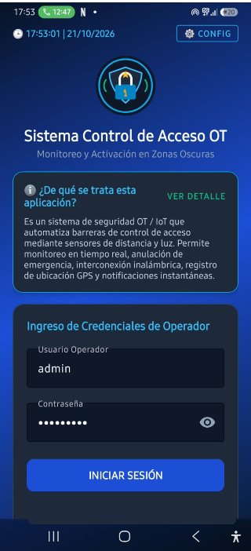
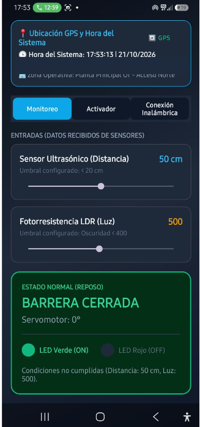
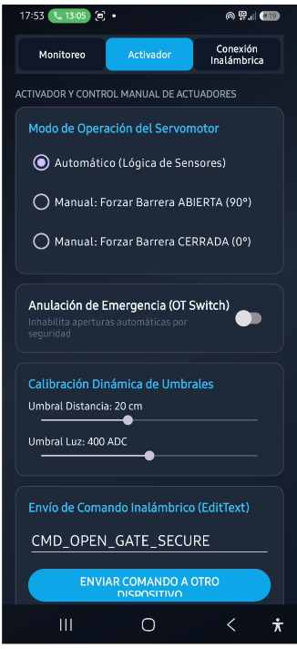
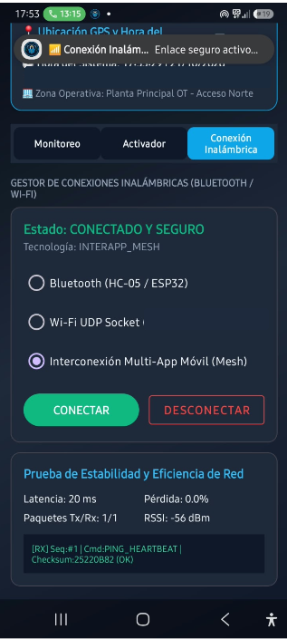
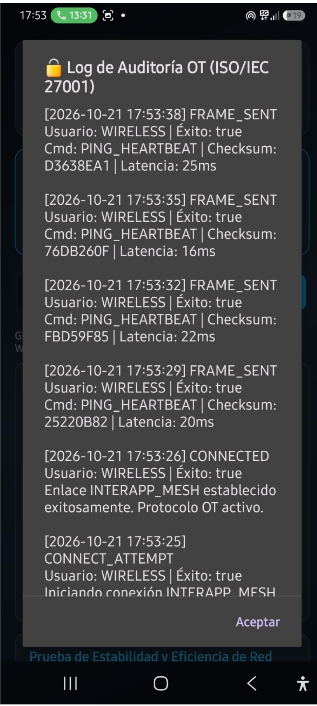
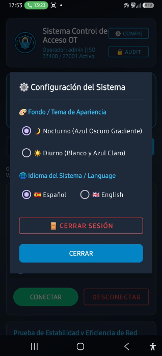
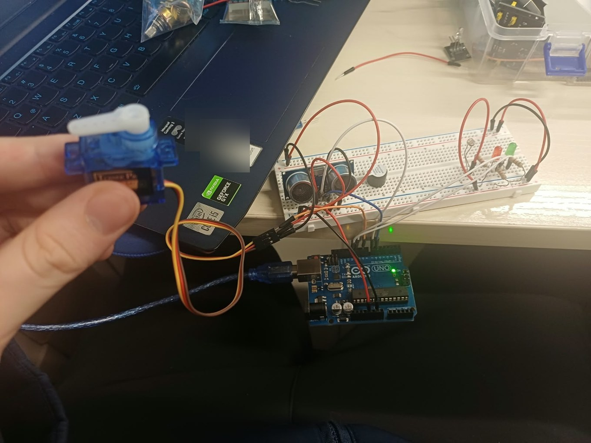
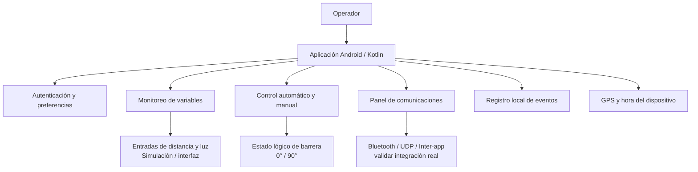

# Sistema de Control de Acceso OT/IoT

**Prototipo académico de aplicación Android nativa para monitoreo y control de accesos en entornos operacionales.**

**Desarrolladores:** Vicente Vega Arroyo · Cristobal Jara · **Formación:** Analista Programador, INACAP Osorno  
**Código:** Kotlin · Android Studio · interfaz Android en XML  
**Repositorio:** https://github.com/Vichosurf/SistemaControlAcceso

> **Estado de la evidencia (21/10/2026).** La documentación reúne capturas reales de la aplicación Android, una fotografía del circuito de prueba y un video breve del montaje con Arduino encendido e indicadores LED cambiando de estado. Estas evidencias muestran una **demostración física de laboratorio**, pero no bastan para afirmar que la app Android se comunica directamente con el Arduino, que el servomotor abre una barrera ni que los sensores tienen una lectura calibrada. No se ha realizado auditoría de código ni certificación de seguridad.

## 1. El problema

Las operaciones de control de accesos en instalaciones técnicas requieren conocer el estado de una barrera, observar variables del entorno y disponer de controles manuales y registros de eventos. Este prototipo explora cómo centralizar esas interacciones en una aplicación móvil, especialmente para escenarios de baja luminosidad.

## 2. La solución

Desarrollé un prototipo Android con pantallas para autenticación, visualización de variables, configuración de umbrales, selección de modos de operación, comunicaciones y consulta de eventos operacionales.

La interfaz permite representar el estado de una barrera (0° cerrada / 90° abierta), la lectura o simulación de distancia y luminosidad y el estado de una conexión inalámbrica. Como complemento, monté un **circuito de pruebas sobre protoboard con Arduino Uno**, un sensor ultrasónico, indicadores LED y un servomotor en el montaje de demostración. En el video se observa la placa alimentada y un cambio visible de estado de los indicadores. **Todavía está pendiente documentar y comprobar la comunicación extremo a extremo entre la aplicación Android y el montaje físico.**

## 3. Capturas del proyecto

| Inicio de sesión | Monitoreo de variables | Control del actuador |
|:--:|:--:|:--:|
|  |  |  |

| Conexión inalámbrica | Registro de eventos | Configuración |
|:--:|:--:|:--:|
|  |  |  |

*Capturas de una ejecución de demostración. Se ocultaron credenciales de ejemplo, coordenadas e información de conexión para evitar divulgación accidental.*

## 4. Prototipo físico: fotografía y video de demostración



**[▶ Ver demostración del montaje físico en video (MP4, aproximadamente 14 segundos)](docs/evidencia/demo_hardware.mp4)**

La evidencia complementaria permite identificar visualmente:

- **Arduino Uno conectado por USB** al computador y con LEDs indicadores encendidos en la placa.
- **Protoboard con cableado de prueba**, un módulo ultrasónico de dos transductores (tipo HC-SR04), LEDs de indicación y otros componentes.
- **Servomotor compacto de carcasa azul**, visible con cableado en la fotografía; su movimiento **no queda acreditado** por los fotogramas revisados del video.
- **Variación visible de los LEDs** durante la grabación: el montaje no es únicamente una representación gráfica en el teléfono.

**Alcance de la demostración:** la fotografía confirma la existencia de un montaje de laboratorio y el video muestra indicadores físicos activos. No permite por sí solo atribuir al sistema móvil el control del circuito, demostrar lecturas de distancia calibradas, comprobar respuesta del servomotor ni medir latencia real de la integración. Para acreditar esas funciones se requiere una prueba filmada de extremo a extremo y la identificación del firmware, puertos, protocolo y comandos utilizados.

| Evidencia disponible | Se observa directamente | Verificación pendiente |
|---|---|---|
| Fotografía física | Arduino Uno, protoboard, módulo ultrasónico, servomotor y LEDs | Diagrama eléctrico, pines usados y conexiones funcionales |
| Video físico de ~14 s | Arduino alimentado y cambio visible en indicadores LED | Origen de la señal, estados programados y pruebas repetibles |
| Capturas Android | Interfaz de monitoreo, activación, conectividad y auditoría | Que esos eventos y controles correspondan al circuito físico mostrado |

## 5. Funcionalidades observables y alcance

| Módulo | Comportamiento mostrado | Qué falta acreditar |
|---|---|---|
| Acceso | Formulario de usuario y contraseña; acceso a configuración | Revisión del esquema real de autenticación y almacenamiento de credenciales |
| Monitoreo | Interfaz de distancia ultrasónica (ejemplo: 50 cm), luminosidad LDR (500), estado de barrera y LEDs; además, se observa un módulo ultrasónico físico en el prototipo | Verificar si los valores de la app provienen del sensor físico; pueden estar simulados |
| Activador | Interfaz con automático, forzar apertura 90°, forzar cierre 0°, anulación de emergencia y umbrales editables; servomotor físico visible en fotografía | Demostrar movimiento físico del servo y vinculación con comandos Android; pruebas de interbloqueos y estados de fallo |
| Comunicaciones | Selectores Bluetooth HC-05/ESP32, Wi-Fi/UDP e inter-app; latencia, pérdida de paquetes, RSSI y tramas | Identificar qué protocolos intercambian datos reales y cuáles son simulaciones |
| Registro de eventos | Marcas de tiempo, eventos de conexión, comandos, checksums y latencias | Integridad resistente a manipulación, retención y exportación de logs |
| Preferencias | Tema oscuro/claro e idiomas español/inglés | Validar cobertura completa de textos e interfaces |
| GPS y reloj | Panel de ubicación y hora del sistema | Permisos, tratamiento de datos y comportamiento sin señal |

### Evidencia visible de una sesión

En las capturas se observan, **a modo de ejemplo de interfaz**, una conexión `INTERAPP_MESH`, un mensaje `PING_HEARTBEAT`, latencia indicada de 20 ms, pérdida de paquetes indicada de 0,0 %, y un registro de eventos. Estos valores son **una fotografía de la sesión**, no estadísticas de rendimiento validadas.

## 6. Arquitectura conceptual



Este diagrama describe **componentes conceptuales de la app observables o reportados** y no pretende representar clases exactas ni un backend desplegado. El montaje experimental con Arduino mostrado arriba se documenta **por separado**, ya que la conexión entre el circuito físico y la app todavía requiere evidencia directa. La integración con Python/FastAPI se considera una posible evolución, **no una característica terminada**.

## 7. Decisiones de diseño

- **Android nativo con Kotlin:** acceso a componentes del sistema operativo, interfaz móvil y funciones del dispositivo.
- **Separación por pestañas:** Monitoreo, Activador y Conexión, para que el operador distinga observación, control y comunicaciones.
- **Umbrales configurables:** permite experimentar con diferentes condiciones de distancia e iluminación.
- **Operación automática y manual:** ofrece distintos modos para observar y demostrar la lógica de control.
- **Tema oscuro y personalización:** se adapta visualmente a condiciones de uso diferentes; esto no sustituye una evaluación formal de accesibilidad.
- **Registro de eventos:** permite seguir las acciones presentadas por la aplicación y depurar su comportamiento.
- **Prototipado con hardware accesible:** uso de Arduino Uno y protoboard para ensayar físicamente señales de entrada/salida; el alcance de cada componente se valida en pruebas reproducibles.

## 8. Consideraciones de seguridad

El proyecto menciona **ISO/IEC 27001, ISO/IEC 27400 e IEC 62443 como referentes de diseño**. No afirmo certificación, conformidad normativa ni aprobación para un entorno OT de producción.

Aspectos que deben revisarse antes de representar la aplicación como segura:

1. **Contraseñas:** un hash SHA-256 directo no es, por sí solo, un mecanismo suficiente de almacenamiento de contraseñas; valorar una función específica de derivación de contraseñas y almacenamiento seguro.
2. **Checksums:** ayudan a detectar ciertos errores de transmisión, pero no demuestran autenticidad criptográfica ni protección ante ataques.
3. **Auditoría:** registrar eventos no garantiza que un archivo local sea inmutable o a prueba de alteraciones.
4. **Comunicación:** verificar cifrado, autenticación del extremo, autorización de comandos, reconexión y límites de confianza.
5. **Control físico:** para una eventual integración real se necesitan enclavamientos, fallos seguros y revisión especializada independiente de la app.

**Uso previsto de esta versión:** demostración académica; no utilizar para operar barreras, instalaciones industriales ni equipos de seguridad críticos.

## 9. Pruebas sugeridas para documentar resultados

| Caso | Condición | Evidencia esperada | Estado |
|---|---|---|---|
| T-01 | Usuario válido / inválido | Captura y resultado del intento | Pendiente de ficha de prueba |
| T-02 | Distancia inferior al umbral | Estado lógico esperado de la barrera | Pendiente |
| T-03 | Luminosidad inferior al umbral | Estado del indicador y decisión | Pendiente |
| T-04 | Forzar apertura y cierre | Transición 0° / 90° y registro | Pendiente |
| T-05 | Anulación de emergencia | Comportamiento consistente y seguro | Pendiente |
| T-06 | Conectar / desconectar | Estado, errores y reintentos | Pendiente |
| T-07 | Cambiar tema e idioma | Persistencia y traducción en pantallas | Pendiente |
| T-08 | Permisos de ubicación | Funcionamiento con permiso denegado | Pendiente |
| T-09 | Alimentación y estado del circuito | Fotografía y video de Arduino encendido | Evidencia visual disponible; falta protocolo de prueba |
| T-10 | Salidas LED en montaje físico | Video de cambio de estado y registro de condiciones de entrada | Cambio visual observado; falta correlación con comandos |
| T-11 | Sensor ultrasónico físico | Registrar distancia medida frente a distancia real | Montaje fotografiado; medición sin validar |
| T-12 | Servomotor físico | Registrar apertura/cierre con ángulos y condiciones de seguridad | Componente fotografiado; movimiento sin validar |
| T-13 | Integración Android ↔ Arduino | Secuencia filmada: orden desde la app → comunicación → respuesta física → log | Pendiente de prueba integral |

> La evidencia visual del montaje **no equivale a aprobar una prueba funcional de extremo a extremo**. Los casos anteriores deben contar con versión, dispositivo, condición inicial, estímulo, resultado esperado, resultado real y evidencia reproducible antes de marcarse como superados.

## 10. Abrir el proyecto

1. Instalar Android Studio y el SDK compatible con los archivos Gradle del repositorio.
2. Clonar el repositorio:

   ```bash
   git clone https://github.com/Vichosurf/SistemaControlAcceso.git
   ```
3. Abrir la carpeta clonada en Android Studio.
4. Esperar la sincronización de Gradle; revisar los requisitos que indique el proyecto.
5. Seleccionar un emulador o teléfono Android compatible y ejecutar la configuración de la aplicación.

**Importante:** el autor debe comprobar la rama estable antes de publicar esta guía: se mencionaron `main` y `Copy-Main`. No se especifican requisitos mínimos de Android o comandos de compilación concretos sin inspeccionar los archivos del repositorio.

## 11. Próximos pasos

- Publicar resultados verificables de las pruebas, con fecha, versión y dispositivo.
- Diferenciar en un anexo las funciones simuladas de las integraciones con hardware verificadas.
- Incorporar el código/firmware de Arduino, diagrama de conexión y tabla de pines, siempre que Vicente confirme que son parte del proyecto.
- Grabar una demostración integral en una sola toma: abrir la app, cambiar un control, observar el efecto físico y revisar el log.
- Revisar manejo de credenciales, registro de eventos y seguridad del transporte.
- Documentar la estructura de paquetes y clases a partir del código real.
- Mantener el video de montaje actualizado; publicar posteriormente una prueba de integración con la app si se confirma, y si corresponde un APK de demostración sin secretos.
- Evaluar integración futura con un servicio backend, **sin presentarla como ya desarrollada**.

## 12. Autoría y contexto

**Vicente Vega Arroyo**  
Estudiante de Analista Programador, INACAP Osorno.  
Proyecto académico de desarrollo móvil y control operacional.  
[Perfil de GitHub](https://github.com/Vichosurf)
